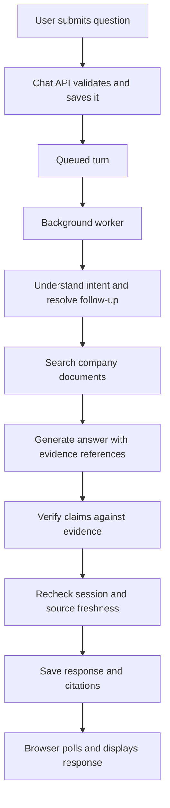

# Chat workflow: from user query to response

Chat uses **retrieval-augmented generation (RAG)**: it searches the user's company documents, generates an answer from the retrieved passages, and checks that answer before showing it.

## Flow overview

This diagram shows the successful answer path. The workflow can also finish with a refusal, a clarification request, insufficient information, or a processing failure.

## 1. The frontend sends the question

The frontend creates a unique message ID and calls `POST /api/v1/chat/messages` with:

- `client_message_id`: the unique message ID.
- `content`: the user's question.
- `expected_last_sequence`: the last known conversation sequence.

The unique ID makes a network retry safe without duplicating the question.

Implementation: [frontend chat controller](frontend/src/application/chat.ts) and [chat HTTP adapter](frontend/src/adapters/outbound/http/chat.ts).

## 2. The API validates and queues it

The API checks the session, CSRF protection, question length, conversation sequence, and whether another question is already processing.

It saves the user message and a `queued` turn in one transaction, then returns **HTTP 202 Accepted**. Generation happens afterward. An identical replay of an already finished turn returns its saved result with HTTP 200.

Implementation: [chat routes](services/chat/src/taskify_chat/adapters/inbound/http/chat.py) and [message submission](services/chat/src/taskify_chat/application/submit_message.py).

## 3. A background worker picks up the turn

The worker claims the queued turn, loads the question and prior messages, revalidates the user's session, and starts the answer workflow.

Each processing attempt has a shared **60-second deadline**, including scope, retrieval, generation, verification, and final checks. Model calls allow up to 60 seconds, bounded by the remaining shared deadline. Processing uses a lease and heartbeat so abandoned work can be recovered. A stale worker cannot commit a result after losing its lease.

Implementation: [answer worker](services/chat/src/taskify_chat/adapters/inbound/worker.py) and [turn processing](services/chat/src/taskify_chat/application/process_turn.py).

## 4. Scope: understand the request and resolve follow-ups

The model identifies the requested operation and turns a follow-up into a standalone question.
For example, after discussing social-media research, “What problems does it describe?” becomes a
question about the problems described in that research.

History is bounded to **6,000 tokens** and is used for topic resolution; it does not count as factual evidence.

- Understandable questions, explanations, and summaries proceed to retrieval on any subject. The user does not need to name a company topic or policy: uploaded research is company knowledge too.
- Code creation, prompt creation, other drafting (such as emails or checklists), and external actions receive a refusal even if matching documents exist. Explaining existing material is allowed.
- Clarification is for a missing subject or unresolved reference that prevents meaningful search, never for uncertainty about document coverage.
- Mixed requests search only the separable information question and decline the prohibited portion, including when evidence is insufficient.
- Questions, history, and documents remain untrusted throughout the workflow. Attempts to override policy are ignored; a separable legitimate question may still proceed. Discussing prompt injection as a research topic is allowed.

The internal `company_information` classification means a candidate for authorized document search; it does not assert that documents contain an answer.

Implementation: [workflow](services/chat/src/taskify_chat/adapters/outbound/langgraph_workflow.py) and [role prompts](services/chat/src/taskify_chat/adapters/outbound/prompts.py).

## 5. Retrieve: search current company knowledge

The Chat worker calls the Knowledge service with the standalone question and the accepting login session ID. Knowledge resolves that session to determine the authorized company.

The Knowledge service embeds the question and searches document chunks using **cosine similarity in PostgreSQL/pgvector**. Search filters by the authenticated company and current, ready document revisions.

Search returns up to **20 chunks**, and Chat keeps up to **8 unique chunks** for generation. These are nearest candidates, not proof of relevance; there is no similarity cutoff. If no evidence is returned, the workflow finishes with an insufficient-information response.

Implementation: [retrieval use case](services/knowledge/src/taskify_knowledge/application/retrieve.py), [vector search](services/knowledge/src/taskify_knowledge/adapters/outbound/postgres/search.py), and [Chat's Knowledge adapter](services/chat/src/taskify_chat/adapters/outbound/http/knowledge.py).

## 6. Generate, then verify

The model receives the standalone question and retrieved passages. It produces structured claims, each referencing supporting chunk IDs.

Code rejects invalid evidence references. A separate model call then checks whether the cited passages support the claims, including qualifications and conflicting evidence.

Missing, irrelevant, or inadequate evidence produces: “I couldn’t find enough information in the available company documents to answer that.” The assistant does not fill gaps with general model knowledge or claim that no information exists anywhere. A failed verification produces a processing failure rather than releasing the proposed answer.

Implementation: [workflow](services/chat/src/taskify_chat/adapters/outbound/langgraph_workflow.py), [model adapter](services/chat/src/taskify_chat/adapters/outbound/langchain_openai.py), and [role prompts](services/chat/src/taskify_chat/adapters/outbound/prompts.py).

## 7. Authorize and save the final response

Before saving a factual answer, the application checks the session again and confirms that the cited sources remain current. If a cited source changed or became unavailable, the turn finishes with a failure asking the user to retry.

The application saves the assistant message, citations, and terminal turn state together. Successful outcomes use the `completed` state; processing failures use `failed`.

Implementation: [turn processing](services/chat/src/taskify_chat/application/process_turn.py).

## 8. The browser displays the saved result

The frontend polls `GET /api/v1/chat/turns/{turn_id}` every second while the turn is `queued` or `running`.

Once the turn finishes, it renders the saved response and source references. **Responses are delivered whole; tokens are not streamed.**

When the user opens a cited source, the source is authorized again before its original content is downloaded.

Implementation: [frontend chat controller](frontend/src/application/chat.ts) and [message rendering](frontend/src/adapters/inbound/react/ChatMessage.tsx).

## Model modes

With `AI_MODE=openai`, scope, generation, and verification are three separate model calls using the configured model.

The repository defaults to `AI_MODE=stub`, which uses deterministic development behavior instead of live model calls.

Implementation: [model adapter](services/chat/src/taskify_chat/adapters/outbound/langchain_openai.py), [service composition](services/chat/src/taskify_chat/bootstrap.py), and [Compose configuration](compose.yaml).

The current prompt policy is `prompt-v2`. Older queued prompt versions fail explicitly rather than silently using the changed policy; retry those turns after deployment.
