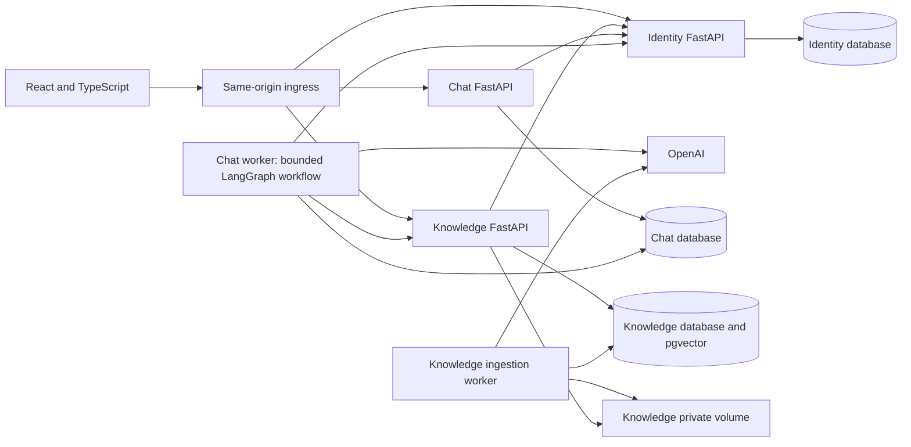
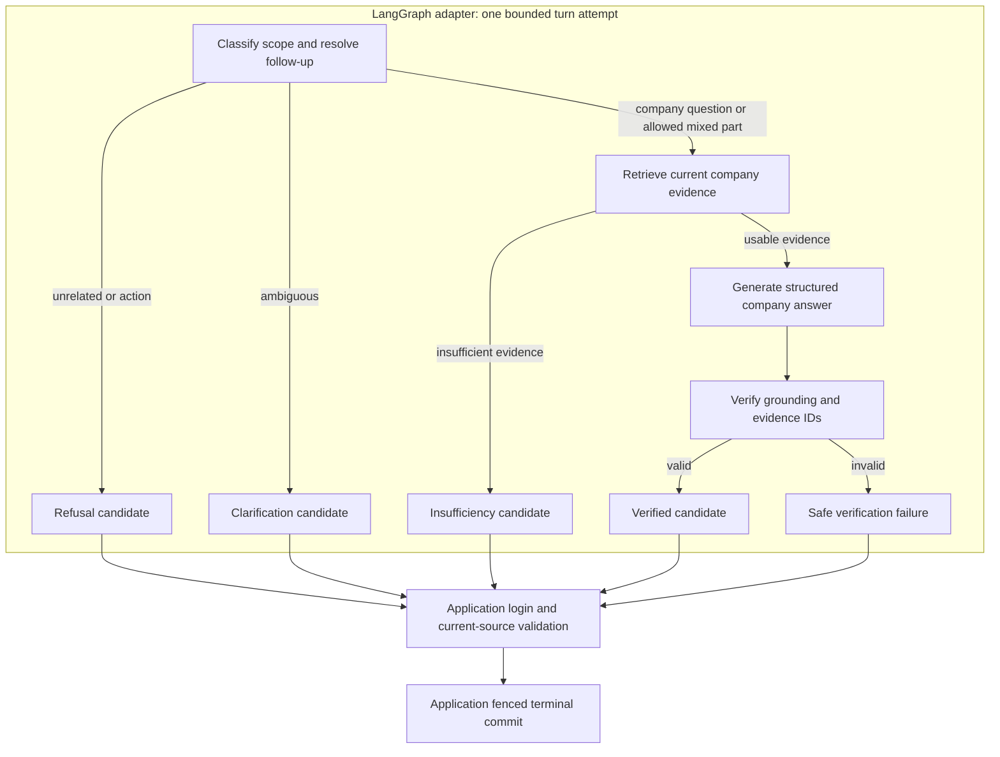

# Implementation Plan: Taskify Company Knowledge Q&A

**Branch**: `main` (actual checkout; workflow feature label: `001-company-knowledge-qa`)
**Date**: 2026-10-20 | **Spec**: [spec.md](spec.md)
**Input**: Feature specification from `specs/001-company-knowledge-qa/spec.md`

## Summary

Build an authenticated company-knowledge chatbot with one saved private conversation per account.
Admins are provisioned through an operator CLI, create company users, and manage document/image
knowledge. Users read and ask contextual questions only within their company. Answers cite the
current authorized resources used; unrelated requests and action requests are refused.

Use three Python/FastAPI microservices, React/TypeScript, hexagonal architecture on both sides,
LangGraph for explicit chat orchestration, LangChain for OpenAI model/embedding integrations,
PostgreSQL/pgvector, and local OCR. Use first-party
email/password login with revocable opaque sessions. See [research](research.md) for evidence,
alternatives, model selection, and the selected embedding process.

### Service and deployment boundaries

| Component | Owns | Ports/adapters and allowed dependencies |
|---|---|---|
| Identity | Companies, accounts, password hashes, login sessions and failed-login limits | FastAPI auth/users; local admin CLI; PostgreSQL; authenticated session introspection |
| Knowledge | Originals, revisions, extraction, chunks, vectors, ingestion jobs and source authorization | FastAPI knowledge/source/internal retrieval; ingestion worker; PostgreSQL/pgvector; private volume; OCR; OpenAI embeddings; Identity validation |
| Chat | Single account-owned conversation, ordered messages, turns and citations | FastAPI chat/history; answer worker; PostgreSQL; LangGraph/LangChain/OpenAI; Knowledge retrieval/final validation; Identity validation |
| Web | Login, first-password-change, single chat/history, source viewing and admin screens | React inbound adapter; typed HTTP outbound adapters; application/domain core; same-origin ingress |

A worker is a deployable process in its owning service, not a separate data owner. Services expose
versioned HTTP contracts; they never query another service's database or mount another owner's
files. A same-origin ingress serves the static web build and routes `/api/v1` prefixes. Only public
routes are proxied. Each backend has independent package locks, image, migrations, and CI checks.



## Technical Context

**Language/Version**: Python 3.14 for Identity (user-directed runtime update on 2026-10-21),
Python 3.12 for Knowledge and Chat; TypeScript 5 in strict mode; React 19; Node.js 22.12+ supported
22.x patch for tooling. Exact patched dependencies and image digests are locked during implementation.

**Primary Dependencies**: FastAPI, Pydantic v2, Uvicorn, SQLAlchemy 2, psycopg 3, Alembic, HTTPX,
`pwdlib[argon2]`, Typer; `langgraph`, `langchain-core`, `langchain-openai`,
`langchain-text-splitters`, tiktoken;
pypdf, pypdfium2, python-docx, Pillow, Tesseract; React, React Router, Vite. No external login provider.

**Storage**: PostgreSQL 16, separate `identity`, `knowledge`, and `chat` databases and roles;
pgvector `vector(1536)` in Knowledge only; Knowledge-only private file volume. Durable ingestion
and turn queues use their owner's PostgreSQL jobs with leases; no Redis or broker initially.

**Testing**: pytest/HTTPX, PostgreSQL/pgvector integration and API contract checks, import-linter;
Vitest/Testing Library, TypeScript/ESLint boundary checks, Playwright; frozen real-provider evaluation
for grounded answers, refusals, OCR retrieval and performance. Test locations appear below.

**Target Platform**: Linux containers on a single-host initial deployment; modern desktop/mobile
browsers. Docker Compose provides the local validation environment. HTTPS is required outside
loopback development. Multi-host object storage and orchestrator deployment are future work.

**Project Type**: Web SPA, three independently deployable backend services, two worker processes,
and an operator-only CLI owned by Identity.

**Performance Goals**: SC-005: p95 end-to-end answer/insufficiency response within 15 seconds for
20 simultaneous questioners. SC-006: at least 95% of the representative supported-file corpus ready
within two minutes of completed upload. Poll accepted turns every second; buffer factual output
until validated. Provider/worker deadlines are bounded but do not substitute for measuring targets.

**Constraints**: All FR-016 limits; one saved private chat/account; no chat tools or external
knowledge; admin functionality stays outside chat. Independent data ownership, inward-only code
dependencies, first-party login, and complete documentation are mandatory. No extra application role.
The file-size range is 1–20,971,520 bytes inclusive; a valid one-byte TXT file passes the size gate.

**Scale/Scope**: Initial benchmark: 10 companies, 100 accounts, 10,000 ready chunks/company,
20 concurrent turns across companies, 20 MiB/upload. These are sizing fixtures, not product quotas.
Scope remains the five specified stories; formats are PDF/DOCX/TXT/PNG/JPEG and printed-text OCR.

### Authentication and validation

Identity issues a random 256-bit cookie token and persists only its digest. In production use
`__Host-taskify_session; Secure; HttpOnly; SameSite=Lax; Path=/` with no Domain. Loopback development
uses `taskify_session` without Secure and explicit local origins. Session inactivity is 30 minutes;
background polling/internal validation does not extend activity. Password change increments an account credential version, revokes all prior sessions, and issues one fresh token in the same transaction. Session creation must check the current credential version to prevent an in-flight old-password login from surviving the change.
A password-change-required login can access only its own session, password change, and logout.

Browser JSON mutations require exact allowed Origin; after login also require a synchronizer
`X-CSRF-Token`. Uploads/deletion/logout/turn submission follow the same checks. Internal endpoints
require caller-specific service credentials and never accept browser identity headers. Services
resolve company/role/account from Identity, fail closed, and enforce their own object policy.
Internal background requests use an Identity-issued login-session ID, not a stored browser secret;
only authenticated permitted services may introspect it. Workers cannot refresh idle sessions.

Adapters validate strict request schemas, UUIDs, bounded files and pagination; domain/application
code repeats invariants. Unknown fields are rejected on mutations, including company/role overrides.
Every database transaction sets trusted company context and, for Chat, account context; RLS is
forced for non-owner application roles. Tests include pooled-connection context reset and jobs.
The detailed input/error rules live in [HTTP contract](contracts/http.md).

### Ingestion, embeddings, and source freshness

1. Validate an admin's upload, stream it to private staged storage with a 20 MiB counter, and
   commit revision plus durable job together; abandoned staged files are reconciled separately.
2. A Knowledge worker claims a leased job, extracts native text or OCR with locators, and produces
   token-aware 800-token chunks with 100-token overlap. No chunk crosses a page/section boundary.
3. Embed chunks in bounded batches using `text-embedding-3-small`, 1,536 dimensions, and save them
   under an immutable pipeline version. Empty/unreadable/unsafe extraction fails visibly.
4. Atomically publish only a fully embedded revision. Keep the old ready pointer during a
   replacement; cancel publication if the item was removed or a competing revision superseded it.
5. Query embeddings use the same configuration. Knowledge applies tenant/current-ready filters
   inside exact cosine search, returning up to 20 candidates. Deduplicate to at most eight chunks.
6. The model sees only these authorized evidence IDs and text. Server-created resource links
   include item, revision, and locator. Before releasing a response, validate all cited revisions
   together through Knowledge and recheck the accepting login; unavailable dependencies fail closed.

Final source validation is single-use within the fenced terminal-commit path; a recovered or expired-lease worker must validate again. Final source validation is the response-release consistency checkpoint. An earlier deletion or
replacement prevents release of a stale draft; a later change affects subsequent answers and
source opens, without rewriting already released historical text. Source links never silently
open a replacement revision at an old citation's locator.
This ordering applies even when a source changes after validation but before Chat's terminal commit
or browser display: the validated answer may still be delivered, while hydrated links and source
opens use current availability. Tests must cover both sides of the checkpoint and lease recovery.

### Chat workflow and persistence

`PUT /chat` atomically gets or creates the account's one conversation. Submit a validated message
with a client UUID and expected conversation sequence; commit the user message and queued turn
before returning 202. A unique active-turn constraint serializes each conversation. The Chat worker
uses short database leases; provider work occurs outside database transactions. Polling exposes
only processing state until the complete, verified outcome is persisted.

Choose LangGraph `StateGraph` for explicit conditional orchestration and LangChain components for
OpenAI calls, prompts and structured outputs. An application-owned `TurnWorkflow` port is implemented
by an outbound LangGraph adapter; `Answerer` remains the model-step port. Inject the existing
KnowledgeGateway and policy functions. No LangGraph/LangChain types or imports enter domain or
application code. The finite graph is versioned and compiled without a checkpointer, store or
result cache. Do not instantiate `create_agent`, Deep Agents, or model tool loops.



History is bounded to 6,000 recent tokens, used for topic resolution rather than factual evidence.
The current question has its own separate input bound. Select the newest complete prior messages
that fit the window, preserving order; omit oldest messages until the limit is met. Never delete
saved history to enforce this bound. A reference absent from that window, even if identifiable in
older saved messages, or an ambiguous reference produces clarification. An unrelated/action request produces refusal;
missing company evidence produces insufficiency; dependency or verification errors produce a
safe retryable failure. A mixed request preserves only the allowed company-information answer
and explicit refusal of the rest. LangChain models receive no tools, browsing, filesystem,
subagent, account-management or knowledge-write capabilities. The graph has no back edges, a
12-step execution limit, and the shared 20-second attempt deadline; no autonomous regeneration.
Graph and SDK retries cannot add to the single allowed transient-provider retry.

Validate the accepting login before supplying own history to the provider. The graph returns an
uncommitted candidate. The application always revalidates the accepting login
and, for factual outcomes, all cited source revisions after graph completion, then performs the
lease-fenced terminal write. An invalid/reused validation result cannot authorize release. Model
or graph routing cannot bypass these checks. Do not report invalid citations as genuine absence
of knowledge: discard the draft and record verification failure. Buffer factual text until commit.

Conversation, message, turn and citation tables remain the sole durable state. Build fresh graph
state for each attempt using authorized SQL history and immutable trusted actor context. Never
reuse state or user-provided thread identifiers across turns/accounts. Recovery reclaims the SQL
turn and reruns from the first graph step with fresh retrieval and final authorization; intermediate
node continuation is not provided. A crash may repeat billable provider calls, but fencing and
idempotent terminal writes prevent duplicate saved assistant responses. Graph snapshots/memory
stores do not create another conversation database. Model, graph, prompt and configuration versions
are pinned on accepted turns; deployment changes cannot silently alter recovered work.
Retrieval configuration is distinct from accepted model/graph/prompt settings: every attempt needing
company evidence calls Knowledge's current retrieval pipeline afresh. `ChatTurn.retrieval_config_version` is
nullable and stays null while pending. The fenced terminal transaction records the version returned
by the terminal attempt's successful search, or null if it had no successful search. Discard any
uncommitted attempt's retrieval metadata on recovery; do not request a pinned version from Knowledge.

### Chat model environment configuration

Use exactly `OPEN_AI_MODEL` for the OpenAI chat-model ID. The backend composition root loads a
validated setting and explicitly passes it to `ChatOpenAI(model=...)`; LangChain does not infer
this application-specific environment name. Require a nonempty, whitespace/control-free model ID
of at most 200 characters when `AI_MODE=openai`, with no code default or legacy environment alias.
The planned `.env.example` shows `OPEN_AI_MODEL=gpt-5.4-mini-2026-03-17` as an editable example.

Compose forwards `OPEN_AI_MODEL` at runtime to both `chat` and `chat-worker`; it is not a React/Vite
build variable or a public request field. Scope resolution, generation and grounding checks use
the model captured from that environment setting on turn acceptance. Store the resolved value,
AI mode, graph version, prompt version and parameter-profile version with the turn. Recovery uses
that accepted configuration; new turns adopt a changed environment after deployment restart.
Drain old work or retain compatible version handlers during rollout. Never silently choose a
new model/mode/graph because an accepted version is unavailable.

Continue using OpenAI Responses API, structured output and `store=false`. Use only optional
parameters supported by the selected model profile; the example snapshot uses
`reasoning.effort=none`, while other profiles omit unsupported options. Missing/invalid local
settings fail readiness without a paid API call. Actual model access, structured-output support
and latency are checked by the opt-in provider smoke/evaluation; a failure is explicit and has
no hidden model fallback. Keep `OPENAI_API_KEY` as a backend secret and embeddings configured
separately through `OPENAI_EMBEDDING_MODEL`/`EMBEDDING_DIMENSIONS`. Chat-model changes do not re-embed
company knowledge. Stub mode uses deterministic test configuration and needs no real model/key.

### Frontend hexagonal boundaries and flows

FR-023 requires `@/` absolute imports rooted at `frontend/src`, including imports from frontend
tests into source code. Configure TypeScript `paths` with `@/*` mapped to `src/*` and Vite's
`resolve.alias` with `@` mapped to the absolute source directory; type-checker paths alone do not
provide runtime resolution. Vitest must use the same Vite alias, Playwright must resolve source
imports through the frontend TypeScript configuration, and ESLint must resolve the same targets.
Use the alias for static/type-only imports, re-exports, literal dynamic imports and imported assets.
Reject relative source references, including same-directory imports. Third-party package specifiers
are unchanged; tooling/test-helper references outside `src` may remain relative. Boundary checks
must inspect resolved targets so aliases cannot bypass the framework-free core. T004 configures
resolution and T005 enforces it, verifies permitted/rejected import cases, and runs frontend
type-check/build/unit/component/e2e checks using alias imports. This keeps imports stable when a
consumer file moves within the source tree.

The TypeScript core defines entities/value objects and application use cases (`LogIn`,
`ChangeInitialPassword`, `OpenConversation`, `SendMessage`, `LoadHistory`, `ReadKnowledge`,
`ManageKnowledge`, `CreateCompanyUser`). Ports include `AuthPort`, `ChatPort`, `KnowledgePort`,
`UsersPort`, `Clock`, and `IdGenerator`. They expose domain types, not Fetch responses or React hooks.

React pages/components are inbound adapters. Typed Fetch clients, DTO decoders, timer/polling,
and UUID generation are outbound adapters. The composition root wires them. Domain and application
modules import neither React, browser globals, nor transport libraries; no shared backend domain
package is required. UI validation improves feedback while server validation remains authoritative.
Credentials are never persisted in localStorage; caches are cleared when identity changes.

Routes and UI outcomes are specified in [frontend contract](contracts/frontend.md), including
keyboard-accessible chat, pending states, refusals, insufficient information, retry, and source
availability. Admin views create users and manage files through their own endpoints, never chat.

### Delivery and verification sequence

Phase 0 is complete in [research.md](research.md): all initial choices (service boundaries,
first-party sessions, LangGraph/LangChain versus Deep Agents, environment-selected model,
embedding process, OCR, durable jobs, storage and frontend structure)
have concrete decisions with alternatives and primary sources.

Phase 1 artifacts are [data-model.md](data-model.md), [contracts](contracts/http.md),
[OpenAPI](contracts/openapi.json), [internal interfaces](contracts/internal.md),
[operator CLI](contracts/cli.md), [frontend behavior](contracts/frontend.md), and
[quickstart.md](quickstart.md). Implementation tasks are intentionally left for `$speckit-tasks`.

Implementation order: service/package and adapter boundaries; Identity/CLI/login; Knowledge
upload/processing/source access; single-chat persistence/turns/retrieval/refusals; React user/admin
flows; cross-service and real-provider evaluation. Seeded fixtures keep each story independently
testable. Every FR and SC is mapped in [quickstart.md](quickstart.md).

Required checks include valid/invalid/boundary inputs for every entry point, role/company/chat
isolation, login revocation (including two concurrent initial-password sessions), CSRF, durable-worker recovery, idempotency, source replacement/removal
during generation, document/history prompt injection, citation entailment, graph branch/deadline
coverage, environment validation and pinned-model recovery, and performance targets.
Check API compatibility from the committed schema and run provider/consumer contract tests.
Domain unit tests use port doubles; real storage/integration checks verify actual invariants.
SC-003 uses a human onboarding study with at least 10 first-time target-role participants per role,
excluding implementers; at least 90% must finish unaided on the first attempt. The admin clock starts
with credentials, task instructions and sample file, pauses only for file processing, and stops when
user creation and upload are complete. The user clock starts with credentials and instructions and
stops after login, initial-password change, answer and source open. Coaching, abandonment and incomplete
flows count as failures. `tests/acceptance_config.py` defines
`ONBOARDING_MIN_PARTICIPANTS_PER_ROLE = 10`; T090 imports it, records configured/actual cohort sizes and
role-specific timings/results, and cannot substitute automated checks for the human study.

Document every Python module/class/function/method and TypeScript module/class/function/method
with purpose, inputs/outputs/errors/side effects; explain non-obvious decisions. Each service ships
setup/configuration, ownership, interface, migration, operation and failure documentation in its
own README. CI combines documentation lint with review of accuracy and service setup instructions.
Redacted logs/metrics cover queues, processing outcomes, provider latency/tokens, and errors;
content, passwords, tokens and private prompts are excluded. Readiness checks required dependencies;
liveness only checks the process. Durable volumes plus separately restored database/file backups
must be exercised before production use. No availability or disaster-recovery certification is
claimed by this planning pass.

## Constitution Check

*Gate evaluated before research and re-evaluated against Phase 1 design.*

| Constitutional requirement | Pre-research | Post-design evidence | Result |
|---|---|---|---|
| I. Question-answering purpose | Chatbot scope and acceptance criteria present | Explicit bounded graph for sourced Q&A, refusals, follow-ups; FR-012–FR-013/FR-019–FR-022 and SC-004/SC-009–SC-012 | PASS |
| II. Every input validated | FR-015–FR-016 cover fields and boundaries | Strict HTTP/CLI/internal/job validation, file-content checks, domain invariants, CSRF and RLS; contracts and negative tests | PASS |
| III. Microservices | Three explicit responsibilities proposed | Separate data/credentials/locks/migrations; HTTP-only inter-service dependencies; versioned contracts and workers owned by service | PASS |
| IV. Complete documentation | Documentation included in delivery scope | Full-code documentation requirement, per-service READMEs, source locators, contracts and runnable validation guide | PASS |
| Architecture/interface constraints | Ownership and entry points identified | Technical Context, data model and public/internal/CLI/UI contracts identify ownership, errors and compatibility | PASS |
| Review and quality gates | Spec checklist 16/16 passing | Review before merge; boundary, contract, integration and real-provider evaluations mapped to every FR/SC | PASS |

No constitutional exceptions are required. Gate PASS describes design compliance, not completed
implementation or successful application tests. The constitution and feature scope remain unchanged.

## Project Structure

### Documentation (this feature)

```text
specs/001-company-knowledge-qa/
├── spec.md
├── plan.md
├── research.md
├── data-model.md
├── quickstart.md
├── checklists/requirements.md
└── contracts/
    ├── openapi.json
    ├── http.md
    ├── internal.md
    ├── cli.md
    └── frontend.md
```

### Source Code (repository root)

Proposed implementation paths; these files are not created by the planning command.

```text
services/
├── identity/
│   ├── pyproject.toml, uv.lock, Dockerfile, README.md
│   ├── src/taskify_identity/
│   │   ├── domain/
│   │   ├── application/        # use cases and owned port protocols
│   │   ├── adapters/inbound/   # FastAPI and operator CLI
│   │   ├── adapters/outbound/  # PostgreSQL, Argon2, clock and tokens
│   │   └── bootstrap.py       # composition root
│   ├── migrations/
│   └── tests/{unit,contract,integration}/
├── knowledge/
│   ├── pyproject.toml, uv.lock, Dockerfile, README.md
│   ├── src/taskify_knowledge/
│   │   ├── domain/
│   │   ├── application/        # upload/publish/retrieve/validate-source use cases and ports
│   │   ├── adapters/inbound/   # FastAPI and durable ingestion worker
│   │   ├── adapters/outbound/  # pgvector, files, parsers/OCR, embeddings, Identity HTTP
│   │   └── bootstrap.py
│   ├── migrations/
│   └── tests/{unit,contract,integration}/
└── chat/
    ├── pyproject.toml, uv.lock, Dockerfile, README.md
    ├── src/taskify_chat/
    │   ├── domain/
    │   ├── application/        # conversation/turn/history use cases and ports
    │   ├── adapters/inbound/   # FastAPI and durable turn worker
    │   ├── adapters/outbound/  # PostgreSQL, LangGraph workflow, LangChain models, Knowledge/Identity HTTP
    │   └── bootstrap.py
    ├── migrations/
    └── tests/{unit,contract,integration}/
frontend/
├── package.json, pnpm-lock.yaml, README.md
├── src/
│   ├── domain/
│   ├── application/           # use cases and ports
│   ├── adapters/inbound/react/
│   ├── adapters/outbound/http/
│   ├── adapters/outbound/browser/
│   └── composition/
└── tests/{unit,component,e2e}/
tests/
├── evaluation/
├── load/
└── fixtures/                  # two-company documents, images and expected evidence
infra/                         # future ingress and database bootstrap configuration
compose.yaml
.env.example
```

**Structure Decision**: One repository holds independently packaged services and a separate SPA.
Only protocol schemas are shared; domain models, ORM objects and repositories are not shared.
Existing `.specify` tooling and feature docs remain in place. No code-generation, migration,
deployment, task generation, or application source work is part of this command.

## Complexity Tracking

No constitutional violations or exemptions. Three services satisfy the required microservices
architecture; durable database jobs and exact pgvector search keep the initial infrastructure
small. A broker, autonomous action tools, provider-hosted threads, and a standalone vector database
are unnecessary for this scope. LangGraph provides explicit conditional flow while existing SQL turns provide durability;
no graph checkpoint store or Deep Agents harness is introduced. Local file storage deliberately
limits initial deployment to one host; its port permits a later multi-host storage adapter.
