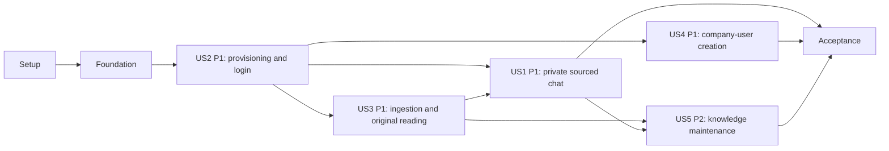

# Tasks: Taskify Company Knowledge Q&A

**Input**: Design documents from `specs/001-company-knowledge-qa/`.
**Prerequisites**: [plan.md](plan.md), [spec.md](spec.md), [research.md](research.md), [data-model.md](data-model.md), [contracts](contracts/http.md), and [quickstart.md](quickstart.md).
**Tests**: Included because the specification explicitly requires acceptance/validation outcomes in SC-001–SC-012 and the constitution requires boundary, contract and integration checks. Write story checks first and establish meaningful failing behavior before implementation; no optional blanket TDD policy is added.
**Organization**: One phase per story, retaining the original US1–US5 IDs. All of US1–US4 have P1 priority; equal-priority stories are ordered by real provisioning/content dependencies, then US5 (P2). Every story has its own fixture-based independent criterion.
**Review ownership**: The existing custom [chatbot checklist](checklists/chatbot.md) remains unchecked and reviewer-owned. Task generation does not evaluate it, change its markers, or approve implementation readiness. The implementation workflow applies its own checklist gate.

## Format: `[ID] [P?] [Story] Description`

- Every task begins with an unchecked checkbox, sequential T-ID, optional [P], and a story label only inside a story phase.
- [P] means a task belongs to a concurrent wave with separate files after its listed dependencies and phase prerequisites are complete; it does not mean all marked tasks can start together.
- Explicit task dependencies supplement phase barriers. Complete Setup before Foundational and complete Foundational before a story. Within a story, tests precede models/use cases/adapters and integration.
- Implementation completion includes current documentation, appropriate passing checks and no violation of company/account ownership or hexagonal dependencies. An unchecked task is not implementation progress.

## Path Conventions

- Backend: independently packaged `services/identity/src/taskify_identity/`, `services/knowledge/src/taskify_knowledge/`, and `services/chat/src/taskify_chat/`, with owned migrations/tests/README/lockfile.
- Frontend: `frontend/src/domain/`, `frontend/src/application/`, `frontend/src/adapters/`, and `frontend/src/composition/`; browser tests are `frontend/tests/e2e/`.
- Cross-service fixtures/evaluation/load checks: `tests/`; infrastructure: `infra/`, `compose.yaml`, `.env.example`.
- Paths are repository-relative implementation targets. Application targets are planned; `tests/acceptance_config.py` already defines the shared onboarding cohort minimum and must be reused.
- Model task descriptions quote the source field lists/invariants, retain `?` optionality, use UUID identifiers and UTC timestamptz, and count Unicode code points unless a byte/token bound is explicitly stated.

## Phase 1: Setup (Shared Infrastructure)

**Purpose**: Initialize independently packaged services, the frontend, local infrastructure, and executable quality tools.

### Implementation

- [X] T001 [P] Initialize the Python 3.14 Identity package (user-directed runtime update on 2026-10-21), uv lock, FastAPI/Pydantic v2, SQLAlchemy/psycopg/Alembic, pwdlib Argon2, Typer, pytest/HTTPX, and independent entry points in `services/identity/pyproject.toml`, `services/identity/uv.lock`, and `services/identity/src/taskify_identity/__init__.py`.
- [X] T002 [P] Initialize the Python 3.12 Knowledge package, uv lock, FastAPI, PostgreSQL/pgvector, LangChain OpenAI embeddings/text splitters, tiktoken, pypdf/pypdfium2/python-docx/Pillow, pytest and worker entry point in `services/knowledge/pyproject.toml`, `services/knowledge/uv.lock`, and `services/knowledge/src/taskify_knowledge/__init__.py`.
- [X] T003 [P] Initialize the Python 3.12 Chat package, uv lock, FastAPI, PostgreSQL, `langgraph`, `langchain-core`, `langchain-openai`, tiktoken, pytest and worker entry point in `services/chat/pyproject.toml`, `services/chat/uv.lock`, and `services/chat/src/taskify_chat/__init__.py`; include no Deep Agents harness.
- [X] T004 [P] Initialize React 19, strict TypeScript, Vite, routing, Vitest/Testing Library and Playwright using pnpm (user-directed package-manager update on 2026-10-21) with framework-free domain/application folders in `frontend/package.json`, `frontend/pnpm-lock.yaml`, `frontend/tsconfig.json`, `frontend/vite.config.ts`, and `frontend/src/composition/main.tsx`; configure `@/` rooted at `frontend/src` for TypeScript paths and an absolute Vite resolve.alias, reuse that mapping in Vitest and Playwright source imports, and use alias imports in frontend source and test consumers (FR-023).
- [X] T005 Configure Python formatting/type/docstring checks and import-linter, TypeScript/ESLint/TSDoc quality checks, and per-service/frontend CI jobs in `services/identity/pyproject.toml`, `services/knowledge/pyproject.toml`, `services/chat/pyproject.toml`, `frontend/eslint.config.js`, and `.github/workflows/taskify.yml`; forbid framework/ORM/provider imports in both domain/application cores and document every module/class/function/method as required by FR-018; enforce FR-023 with ESLint rejecting relative imports into/within `frontend/src` (including same-directory, type-only, re-export and literal dynamic forms), resolve aliases before layer checks, and verify allowed alias/package imports plus rejected relative/boundary cases through lint/type-check/build/unit/component/e2e workflows. Depends on T001, T002, T003, T004.
- [X] T006 Define independent service Dockerfiles, Tesseract English/Spanish dependencies, PostgreSQL 16 with pgvector only in Knowledge, runtime images and worker commands in `services/identity/Dockerfile`, `services/knowledge/Dockerfile`, `services/chat/Dockerfile`, `frontend/Dockerfile`, and `compose.yaml`; mount private originals only in Knowledge API/worker, never expose internal routes, and keep the initial deployment single-host. Depends on T001, T002, T003, T004.
- [X] T007 Create secret-safe local/runtime configuration documentation in `.env.example`, `.gitignore`, and `compose.yaml`; explicitly forward exactly `OPEN_AI_MODEL` to Chat API/worker, keep OPENAI_API_KEY backend-only and embedding settings independent, distinguish stub/OpenAI modes, preserve existing ignore rules, and provide no silent chat-model fallback. Depends on T006.
- [X] T008 Define a versioned two-company corpus manifest and fixture-generation utilities in `tests/fixtures/corpus/manifest.json` and `tests/fixtures/build_corpus.py`, including native/scanned PDFs, DOCX tables, TXT, PNG/JPEG text, conflicting facts, malicious instructions, expected locations and invalid files; include the 50 answerable/20 unanswerable/20 multi-turn/30 adversarial minimums from SC-004/SC-009/SC-010. Depends on T002.

**Checkpoint**: Phase artifacts and their required checks are complete before dependent work begins.

---

## Phase 2: Foundational (Blocking Prerequisites)

**Purpose**: Create service-owned infrastructure and stable ports before any story implementation. These tasks do not grant an authentication bypass.

**Blocking gate**: Complete all foundational tasks before any story. Existing custom checklist decisions remain with the reviewer; this task file does not alter them.

### Implementation

- [X] T009 Bootstrap three databases with separate migration/runtime credentials and non-owner/non-superuser/no-BYPASSRLS roles in `infra/postgres/bootstrap.sql`; initialize `services/identity/alembic.ini`, `services/knowledge/alembic.ini`, `services/chat/alembic.ini` and each `migrations/env.py`; enforce no cross-service grants and quote the common identity rules “All identifiers are UUIDs; timestamps are UTC” and “Text lengths count Unicode code points, not bytes, unless explicitly stated.” in migration/schema documentation. Depends on T006.
- [X] T010 [P] Implement Identity-owned value objects and validation in `services/identity/src/taskify_identity/domain/values.py` with literal constraints “Trim; 1–100 code points; reject control characters”, “Valid address syntax, at most 254 characters; case-insensitive uniqueness”, and “12–128 code points; no trimming/truncation; new password differs on first change”; keep validation independent from FastAPI/Pydantic/ORM. Depends on T009.
- [X] T011 [P] Implement Knowledge-owned title, identifier, pagination, file and locator value objects in `services/knowledge/src/taskify_knowledge/domain/values.py` and `services/knowledge/src/taskify_knowledge/domain/locators.py` with “Trim; 1–200 code points; reject control characters”, “1–255 characters, no separators/control characters; 1–20,971,520 bytes inclusive; allowlisted MIME and matching extension/content”, “Valid UUID; positive item version; sequence integer >= 0”, and “`limit` 1–100, default 50; opaque bounded cursor <= 512 characters, scoped to query/owner”. Depends on T009.
- [X] T012 [P] Implement Chat-owned message, identifier, sequence and pagination values in `services/chat/src/taskify_chat/domain/values.py` with “Trim; 1–4000 code points”, “Valid UUID; positive item version; sequence integer >= 0”, and “`limit` 1–100, default 50; opaque bounded cursor <= 512 characters, scoped to query/owner”; distinguish login sessions from saved conversations. Depends on T009.
- [X] T013 Implement each service-owned unit-of-work and transaction-context port/adapter in `services/identity/src/taskify_identity/application/ports/persistence.py`, `services/identity/src/taskify_identity/adapters/outbound/postgres/unit_of_work.py`, `services/knowledge/src/taskify_knowledge/application/ports/persistence.py`, `services/knowledge/src/taskify_knowledge/adapters/outbound/postgres/unit_of_work.py`, `services/chat/src/taskify_chat/application/ports/persistence.py`, and `services/chat/src/taskify_chat/adapters/outbound/postgres/unit_of_work.py`; set trusted company/account context transaction-locally, reset pooled connections, and grant workers only narrow unscoped claim functions. Depends on T010, T011, T012.
- [X] T014 Define separately owned SessionValidator/KnowledgeGateway/Clock/IdGenerator and workflow/model protocols in `services/knowledge/src/taskify_knowledge/application/ports/identity.py`, `services/chat/src/taskify_chat/application/ports/identity.py`, `services/chat/src/taskify_chat/application/ports/knowledge.py`, `services/chat/src/taskify_chat/application/ports/workflow.py`, `services/chat/src/taskify_chat/application/ports/answerer.py`, and each service's `application/ports/clock.py`; use plain core DTOs, no provider/framework types, and preserve contracts/internal.md scopes and typed failure distinctions. Depends on T013.
- [X] T015 Implement strict transport DTO/error mapping, safe request IDs, no-store headers, mutation Origin/CSRF policy hooks, nonpublic live/ready handlers and redacted logging in `services/identity/src/taskify_identity/adapters/inbound/http/common.py`, `services/knowledge/src/taskify_knowledge/adapters/inbound/http/common.py`, and `services/chat/src/taskify_chat/adapters/inbound/http/common.py`; preserve the public Error shape, reject unknown mutation fields, and never disclose tokens, private data or parser/provider errors. Depends on T014.
- [X] T016 Implement scoped authenticated TLS-capable Identity HTTP adapters and their contract doubles in `services/knowledge/src/taskify_knowledge/adapters/outbound/http/identity.py`, `services/chat/src/taskify_chat/adapters/outbound/http/identity.py`, `services/knowledge/tests/contract/test_identity_consumer.py`, and `services/chat/tests/contract/test_identity_consumer.py`; enforce mutually exclusive session selectors, trusted handler-selected activity, no positive cache/idle refresh for polling or workers, and fail-closed dependency errors. Depends on T015.
- [X] T017 Implement bootstrap-only validated settings in `services/identity/src/taskify_identity/adapters/outbound/settings.py`, `services/knowledge/src/taskify_knowledge/adapters/outbound/settings.py`, and `services/chat/src/taskify_chat/adapters/outbound/settings.py`; require OPEN_AI_MODEL in OpenAI mode with a nonempty whitespace/control-free ID of at most 200 characters, pass no model fallback/alias, forbid stub mode in production, keep embedding dimensions 1536, and make local readiness checks nonbillable. Depends on T007, T015.
- [X] T018 [P] Define framework-free core result/error/attachment/clock/ID types and inject browser/fetch/timer adapters in `frontend/src/domain/common.ts`, `frontend/src/application/ports/common.ts`, `frontend/src/adapters/outbound/http/client.ts`, `frontend/src/adapters/outbound/browser/runtime.ts`, and `frontend/src/composition/dependencies.ts`; use cookies and in-memory CSRF, decode unknown response data, constrain source URLs to same origin, and keep credentials/private content out of persistent browser storage. Depends on T017.
- [X] T019 [P] Create real-PostgreSQL/pgvector/RLS fixture factories and contract-safe principal/provider doubles in `services/identity/tests/conftest.py`, `services/knowledge/tests/conftest.py`, and `services/chat/tests/conftest.py`; seed only service-owned test databases and include a controllable clock plus invalid/cross-owner fixtures, never add a public seed/auth-bypass route. Depends on T017.
- [X] T020 Implement static same-origin ingress and health-only internal exposure in `infra/nginx/default.conf` and `frontend/Dockerfile`, and connect service hostnames/ports in `compose.yaml`; strip spoofable identity headers, allow multipart envelope overhead while each file remains capped at 20 MiB, keep `/internal` nonpublic and require HTTPS/TLS outside loopback. Depends on T018, T019.

**Checkpoint**: Phase artifacts and their required checks are complete before dependent work begins.

---

## Phase 3: User Story 2 - Provision an Admin and Log In (Priority: P1)

**Goal**: Deliver operator CLI provisioning and first-party login, first-password change, logout and service session validation.

**Independent Test**: Provision first/additional admins, complete first login, and establish protected same-company access; incorrect credentials, rate pauses, CSRF, expiry, two initial-password sessions and racing password changes must satisfy US2/SC-002 independently of other stories.

### Tests

- [X] T021 [P] [US2] Write the public auth/CLI/internal-session contract expectations in `services/identity/tests/contract/test_auth.py`, `services/identity/tests/contract/test_cli.py`, and `services/identity/tests/contract/test_session_resolution.py`, covering all four auth operations, CLI exit codes, internal selector/activity scopes and safe errors; cite FR-003/FR-005/FR-006 and contracts/openapi.json.
- [X] T022 [P] [US2] Write real-storage login/provisioning isolation and race specifications in `services/identity/tests/integration/test_identity_security.py` for atomic company rollback, duplicate case-insensitive emails, lockout, idle expiry, credential-version fencing, multi-session invalidation and nonrefreshing background activity (SC-002/SC-008).
- [X] T023 [P] [US2] Write port-driven first-login/logout/error requirements in `frontend/tests/component/auth.test.tsx` and `frontend/tests/e2e/auth.spec.ts`, including account-switch cache clearing and absence of external signup/login providers.
### Implementation

- [X] T024 [P] [US2] Create domain models in `services/identity/src/taskify_identity/domain/company.py` and `services/identity/src/taskify_identity/domain/account.py`: Company fields “`id`, `name`, `created_at`”; invariants “Name trimmed, 1–100 characters; first admin and company commit in one transaction”; Account fields “`id`, `company_id`, `email`, `normalized_email`, `display_name`, `role`, `password_hash`, `credential_version`, `must_change_password`, `created_at`, `password_changed_at`”; invariants “Unique normalized email across companies; role exactly `admin` or `user`; company immutable in this scope; password never persisted as plaintext”; default must_change_password=true and make password_changed_at nullable until the first change. Depends on T021, T022.
- [X] T025 [P] [US2] Create domain models in `services/identity/src/taskify_identity/domain/session.py` and `services/identity/src/taskify_identity/domain/login_attempt.py`: LoginSession fields “`id`, `account_id`, `token_digest`, `credential_version`, `csrf_secret`, `created_at`, `last_activity_at`, `revoked_at`”; invariants “Unique digest of a random 256-bit token; 30-minute idle expiry; account role/company resolved from Account; no access except auth/password/logout while initial password change is pending”; LoginAttemptWindow fields “`email_key`, `window_started_at`, `failure_count`, `blocked_until`”; invariants “HMAC of normalized email, including unknown emails; atomic failure accounting; five failures in 15 minutes impose a 15-minute pause; no account-existence disclosure”; revoked_at and blocked_until are nullable until applicable, and expired/credential-version-mismatched sessions are invalid before cleanup. Depends on T021, T022.
- [X] T026 [US2] Create ORM mappings, schema constraints, tenant policies and repositories in `services/identity/src/taskify_identity/adapters/outbound/postgres/models.py`, `services/identity/src/taskify_identity/adapters/outbound/postgres/repositories.py`, and `services/identity/migrations/versions/0001_identity.py`; preserve quoted entity constraints, narrow global email/session lookup access, unique email/token digests and atomic failure counters. Depends on T024, T025.
- [X] T027 [P] [US2] Implement Argon2id verification, dummy-hash unknown-email checks, random token/digest generation and synchronizer CSRF in `services/identity/src/taskify_identity/adapters/outbound/security/passwords.py` and `services/identity/src/taskify_identity/adapters/outbound/security/tokens.py`; use 256-bit login tokens, recorded hash parameters and no secret echoes or logs. Depends on T024, T025.
- [X] T028 [US2] Implement all-or-nothing new-company/first-admin and existing-company/additional-admin use cases in `services/identity/src/taskify_identity/application/provision_admin.py`; use validated company/name/email/password values and unique email enforcement, always issue the admin role with mandatory first change and roll back failures. Depends on T026, T027.
- [X] T029 [US2] Implement login, current-session resolution, initial-password change and logout in `services/identity/src/taskify_identity/application/authenticate.py`, `services/identity/src/taskify_identity/application/change_password.py`, and `services/identity/src/taskify_identity/application/logout.py`; quote “now - last_activity_at >= 30 minutes” and “all previous account sessions revoked”; increment credential version, revoke old sessions and issue one fresh session atomically, with login session insertion fenced against old-password races. Depends on T028.
- [X] T030 [P] [US2] Implement `taskify-admin create` in `services/identity/src/taskify_identity/adapters/inbound/cli.py` using exactly one --company-name/--company-id, hidden confirmation or --password-stdin, documented JSON/exit codes and the provisioning use case; do not add password arguments or public admin-creation routes. Depends on T029.
- [X] T031 [P] [US2] Implement POST /auth/login, GET /auth/session, PUT /auth/password and POST /auth/logout under /api/v1 in `services/identity/src/taskify_identity/adapters/inbound/http/auth.py`; apply restricted first-change access, generic 401/429 outcomes/Retry-After, precise Origin plus authenticated CSRF, no-store and production __Host-taskify_session cookie flags, then rotate/expire cookies as contracted. Depends on T029.
- [X] T032 [P] [US2] Implement service-authenticated POST /internal/v1/sessions/resolve in `services/identity/src/taskify_identity/adapters/inbound/http/internal_sessions.py`, validating the exact optional-selector/required-CSRF/activity contract and credential version without exposing cookie secrets, permitting background session IDs only to authorized callers and failing closed. Depends on T029.
- [X] T033 [P] [US2] Implement frontend AuthPort, identity values and login/password/logout/session use cases in `frontend/src/domain/identity.ts`, `frontend/src/application/ports/auth.ts`, and `frontend/src/application/auth.ts`, preserving required first-password change and clearing account-bound state on logout/account switch. Depends on T023.
- [X] T034 [US2] Implement typed auth DTO mapping, forms and protected route guards in `frontend/src/adapters/outbound/http/auth.ts`, `frontend/src/adapters/inbound/react/LoginPage.tsx`, `frontend/src/adapters/inbound/react/ChangePasswordPage.tsx`, and `frontend/src/adapters/inbound/react/ProtectedRoute.tsx`; provide labelled fields, generic errors and keyboard access without storing passwords/tokens in browser persistence. Depends on T031, T033.
- [X] T035 [US2] Wire Identity HTTP/CLI/storage/security composition and frontend auth routes in `services/identity/src/taskify_identity/bootstrap.py`, `frontend/src/composition/dependencies.ts`, and `frontend/src/composition/router.tsx`; document setup/configuration/CLI/ownership/failure semantics in `services/identity/README.md` and run the US2 contract/integration/component checks without requiring any AI provider. Depends on T030, T032, T034.

**Checkpoint**: Story acceptance slice passes with prepared fixtures; full delivery waits for the dependency gates below.

---

## Phase 4: User Story 3 - Load Company Documents and Images (Priority: P1)

**Goal**: Deliver company-owned file ingestion, text/OCR extraction, versioned embeddings, current-source reading and visible processing outcomes.

**Independent Test**: With prepared company accounts, each supported native/scanned document or image becomes ready or an explanatory failure; same-company users can read originals and unauthorized/unready content stays inaccessible. Use real local extraction and deterministic embeddings initially (SC-006/SC-008).

### Tests

- [X] T036 [P] [US3] Write upload/list/item/revision/source contract expectations in `services/knowledge/tests/contract/test_knowledge.py` and `services/knowledge/tests/contract/test_sources.py`, covering role/company denials, all supported formats, statuses, current-original links, file limits (valid one-byte TXT, zero bytes, exactly 20,971,520 bytes and 20,971,521 bytes) and no partial accepted data (FR-007–FR-009/FR-014–FR-017).
- [X] T037 [P] [US3] Write real parser/OCR, staging/publication/lease and source-provenance requirements in `services/knowledge/tests/integration/test_ingestion.py`, including process restart, malformed/mismatched/protected/empty files, original identity, resource limits, no empty ready revision and RLS context reuse.
- [X] T038 [P] [US3] Write port-driven admin-upload/status and user-read expectations in `frontend/tests/component/knowledge.test.tsx` and `frontend/tests/e2e/knowledge.spec.ts`, including safe errors, source locations and denial of user editing controls.
### Implementation

- [X] T039 [US3] Create KnowledgeItem and KnowledgeRevision domain models in `services/knowledge/src/taskify_knowledge/domain/item.py` and `services/knowledge/src/taskify_knowledge/domain/revision.py`: KnowledgeItem fields “`id`, `company_id`, `title`, `created_by`, `active_revision_id?`, `candidate_revision_id?`, `version`, `created_at`, `updated_at`, `removed_at?`”; invariants “Title trimmed 1–200 characters; current pointer must reference this item's ready revision; removed items are never readable/searchable; version increments on mutations”; KnowledgeRevision fields “`id`, `company_id`, `item_id`, `uploaded_by`, `original_filename`, `media_type`, `size_bytes`, `sha256`, `storage_key`, `state`, `pipeline_version`, `error_code?`, `created_at`, `ready_at?`”; invariants “Immutable file identity; size 1–20,971,520 bytes; matching supported content/extension; unique private storage key; no more than one candidate processing revision/item”; preserve nullable “active_revision_id?”, “candidate_revision_id?”, “removed_at?”, “error_code?”, and “ready_at?”; include processing/ready/failed/superseded/cancelled revision states. Depends on T036, T037.
- [X] T040 [US3] Create extraction/chunk/pipeline models in `services/knowledge/src/taskify_knowledge/domain/block.py`, `services/knowledge/src/taskify_knowledge/domain/chunk.py`, and `services/knowledge/src/taskify_knowledge/domain/pipeline.py`: ExtractedBlock fields “`id`, `company_id`, `revision_id`, `ordinal`, `normalized_text`, `locator`, `source_offset_map`, `extractor_version`”; invariants “Non-empty UTF-8 text; monotonic source ordering; page/section/line/OCR provenance retained; extraction output cannot change the original”; KnowledgeChunk fields “`id`, `company_id`, `item_id`, `revision_id`, `block_id`, `ordinal`, `text`, `token_count`, `locator`, `text_sha256`, `pipeline_version`, `embedding_model`, `dimensions`, `embedding`”; invariants “Non-empty text, at most 800 tokens; no page/section boundary crossing; 100-token overlap where possible; dimensions exactly 1536 for initial model; unique `(revision_id, pipeline_version, ordinal)`”; PipelineConfiguration fields “`version`, `normalization_version`, `extractor_versions`, `splitter_name`, `chunk_tokens`, `overlap_tokens`, `embedding_model`, `dimensions`, `tokenizer`, `created_at`”; invariants “Immutable version; initial values NFC/newline normalization, recursive token splitter, 800/100, text-embedding-3-small, 1536, cl100k_base”. Depends on T039.
- [X] T041 [US3] Create the ingestion job state machine in `services/knowledge/src/taskify_knowledge/domain/ingestion_job.py`: IngestionJob fields “`id`, `company_id`, `revision_id`, `pipeline_version`, `state`, `attempt_count`, `run_after`, `lease_owner?`, `lease_until?`, `lease_version`, `heartbeat_at?`, `last_error_code?`, `created_at`”; invariants “One logical job/revision/pipeline; worker claims outside long transactions; transient retry limit three; stale lease holders cannot publish”; preserve nullable “lease_owner?”, “lease_until?”, “heartbeat_at?”, and “last_error_code?” and the exact job states “queued”, “running”, “succeeded”, “failed”, or “cancelled”. Depends on T040.
- [X] T042 [US3] Create service-owned ORM/repositories/schema with vector(1536), composite ownership constraints, current pointers, tenant policies and fenced job claims in `services/knowledge/src/taskify_knowledge/adapters/outbound/postgres/models.py`, `services/knowledge/src/taskify_knowledge/adapters/outbound/postgres/repositories.py`, and `services/knowledge/migrations/versions/0001_knowledge.py`; preserve entity optionality, immutable pipeline versions and all quoted constraints. Depends on T041.
- [X] T043 [P] [US3] Implement a private ObjectStorage port and filesystem adapter in `services/knowledge/src/taskify_knowledge/application/ports/storage.py` and `services/knowledge/src/taskify_knowledge/adapters/outbound/filesystem.py`; generate server-owned immutable keys, stream with a 20 MiB counter and matching filename/content validation, forbid traversal, reconcile abandoned staged files and never expose private paths or public permanent URLs. Depends on T042.
- [X] T044 [P] [US3] Implement isolated TXT/DOCX/PDF/image text extraction in `services/knowledge/src/taskify_knowledge/application/ports/extraction.py` and `services/knowledge/src/taskify_knowledge/adapters/outbound/extraction.py`: UTF-8/BOM TXT, ordered DOCX paragraphs/tables, native PDF text with PDFium+Tesseract fallback, and Pillow/Tesseract images; preserve locators “{kind: "pdf", page: positive integer, text_start?, text_end?}”, “{kind: "docx", heading_path: string[], block: nonnegative integer, table?, row?, cell?}”, “{kind: "text", line_start: positive integer, line_end: integer >= line_start}”, and “{kind: "image", page: 1, bbox?: [x, y, width, height]}”; enforce the research R-05 resource limits with explicit failures, never truncation. Depends on T042.
- [X] T045 [P] [US3] Implement token-aware splitter and OpenAI/deterministic Embedder adapters in `services/knowledge/src/taskify_knowledge/adapters/outbound/chunking.py` and `services/knowledge/src/taskify_knowledge/adapters/outbound/embeddings.py`; retain NFC/newline/source offsets, page/section boundaries, 800/100 token chunk/overlap, cl100k_base, text-embedding-3-small at 1536 dimensions, <=32 chunks/25,600 tokens per batch, finite ordered vectors and explicit model-space mismatch errors. Depends on T042.
- [X] T046 [US3] Implement atomic validated upload/revision/job acceptance plus authorized list/read/revision-status/source use cases in `services/knowledge/src/taskify_knowledge/application/upload.py` and `services/knowledge/src/taskify_knowledge/application/read_knowledge.py`; a staged object precedes the transaction, users see only ready originals, admins see failed/processing outcomes and item ETags, and reject invalid inputs without domain changes. Depends on T043, T044, T045.
- [X] T047 [US3] Implement leased ingestion, idempotent chunk staging and atomic ready publication in `services/knowledge/src/taskify_knowledge/application/process_ingestion.py` and `services/knowledge/src/taskify_knowledge/adapters/inbound/worker.py`; use a 120-second lease, <=10-second heartbeats, three transient retries/backoff, no retry of invalid files, short claims outside provider work, and candidate/lease/removal checks before switching the active revision. Depends on T046.
- [X] T048 [US3] Implement public list/upload/item/revision-status/current-source handlers in `services/knowledge/src/taskify_knowledge/adapters/inbound/http/knowledge.py` and `services/knowledge/src/taskify_knowledge/adapters/inbound/http/sources.py`; apply Identity/role/CSRF rules, 202 durable acceptance, safe processing errors, ETags, no-store/nosniff and current exact-revision source authorization per contracts/http.md. Depends on T047.
- [X] T049 [P] [US3] Implement frontend knowledge domain/ports/read/upload/status use cases in `frontend/src/domain/knowledge.ts`, `frontend/src/application/ports/knowledge.ts`, and `frontend/src/application/knowledge.ts`; wrap browser File behind the application attachment abstraction and retain source-availability/validation outcomes without exposing server internals. Depends on T038.
- [X] T050 [US3] Implement DTOs, knowledge lists/source viewing and admin upload/status forms in `frontend/src/adapters/outbound/http/knowledge.ts`, `frontend/src/adapters/inbound/react/KnowledgePage.tsx`, and `frontend/src/adapters/inbound/react/AdminKnowledgePage.tsx`; offer user read/download only, labelled errors and processing/failed/ready feedback without changing valid originals. Depends on T048, T049.
- [X] T051 [US3] Wire Knowledge API/worker/embedding/storage composition and frontend routes in `services/knowledge/src/taskify_knowledge/bootstrap.py`, `frontend/src/composition/dependencies.ts`, and `frontend/src/composition/router.tsx`; document file formats, OCR/resource limits, original/source provenance, queues and pipeline upgrade rules in `services/knowledge/README.md`; run US3 checks with real extractors and provider doubles. Depends on T050.

**Checkpoint**: Story acceptance slice passes with prepared fixtures; full delivery waits for the dependency gates below.

---

## Phase 5: User Story 4 - Create Company Users (Priority: P1)

**Goal**: Allow a company admin to provision user-role client accounts without company or privilege overrides.

**Independent Test**: A prepared admin creates a user, the user completes initial login and reads its company knowledge, and duplicate/invalid creation or company/admin-role override leaves accounts unchanged; no chat implementation is required (FR-004/SC-002/SC-003/SC-008).

### Tests

- [X] T052 [P] [US4] Write POST /api/v1/users contract and role/company/duplicate/CSRF rollback expectations in `services/identity/tests/contract/test_users.py` and `services/identity/tests/integration/test_user_creation.py`; require the returned role=user, generic cross-company duplicate errors and mandatory first-password change.
- [X] T053 [P] [US4] Write user creation form/role-gate requirements in `frontend/tests/component/create_user.test.tsx` and `frontend/tests/e2e/users.spec.ts`, including no role/company selector and no persistence or notification echo of the initial password.
### Implementation

- [X] T054 [US4] Implement the admin-only CreateCompanyUser use case in `services/identity/src/taskify_identity/application/create_user.py`, deriving company/role from the authenticated principal, reusing Account validation and Argon2, always setting user and must_change_password=true, and using an atomic unique-email transaction with no partial account. Depends on T052.
- [X] T055 [US4] Implement strict POST /api/v1/users DTOs and authenticated handler in `services/identity/src/taskify_identity/adapters/inbound/http/users.py`; reject company/role/unknown-field overrides, apply Origin/CSRF and password-change restrictions, and return the contracted 201 Account or safe generic errors. Depends on T054.
- [X] T056 [P] [US4] Implement frontend UsersPort, CreateCompanyUser use case and typed DTO client in `frontend/src/application/ports/users.ts`, `frontend/src/application/create_user.ts`, and `frontend/src/adapters/outbound/http/users.ts`; preserve name/email/password bounds, safe typed errors and credential clearing. Depends on T053.
- [X] T057 [US4] Implement the labelled admin-only user form in `frontend/src/adapters/inbound/react/CreateUserPage.tsx`; expose only display name/email/initial password, no company/admin options, generic duplicate errors and the documented trusted-channel handoff. Depends on T055, T056.
- [X] T058 [US4] Wire Identity/public user routing and frontend admin navigation in `services/identity/src/taskify_identity/bootstrap.py`, `frontend/src/composition/dependencies.ts`, and `frontend/src/composition/router.tsx`; update `services/identity/README.md` and run the user-creation/login acceptance slice using the real Identity service. Depends on T057.

**Checkpoint**: Story acceptance slice passes with prepared fixtures; full delivery waits for the dependency gates below.

---

## Phase 6: User Story 1 - Chat About Company Knowledge (Priority: P1)

**Goal**: Deliver the single saved private chatbot, current company evidence, linked factual answers, contextual follow-ups, refusals and recovery.

**Independent Test**: With prepared two-company accounts and ready content, obtain linked answers and contextual follow-ups; distinguish insufficiency, ambiguity, refusal and failure; preserve one private history across reload/login, deny other-account/admin reads, and reject stale sources and action requests (US1/SC-004/SC-009–SC-012).

### Tests

- [X] T059 [P] [US1] Write chat/open/history/send/poll and Knowledge retrieval/source-validation contract expectations in `services/chat/tests/contract/test_chat.py`, `services/chat/tests/contract/test_knowledge_consumer.py`, and `services/knowledge/tests/contract/test_retrieval.py`; cover duplicate UUID replay, sequence conflicts, exact source membership, fresh titles/availability and no public model override.
- [X] T060 [P] [US1] Write real-storage private history, final-source, worker-recovery and accepted-model invariants in `services/chat/tests/integration/test_chat_security.py` and `services/knowledge/tests/integration/test_retrieval_isolation.py`; include cross-company/same-company-admin access, pooled RLS, revoked login, changed evidence, obsolete lease, and accepted model/config A preserved after rollout B, plus retrieval config R1 interrupted then recovered under active R2 with fresh evidence and terminal R2 audit metadata; pending/no-search versions are null.
- [X] T061 [P] [US1] Write bounded graph/model-setting requirements in `services/chat/tests/unit/test_graph_routing.py` and `services/chat/tests/unit/test_model_configuration.py`: all terminal branches, mixed requests, document/history overrides, no tools/checkpointer, 12 steps/20 seconds/one shared retry, exact OPEN_AI_MODEL validation and explicit model propagation to all LLM roles; test history within/exactly-at/beyond 6,000 tokens, oldest-message exclusion, clarification for omitted topics and preserved full history.
- [X] T062 [P] [US1] Write port-driven history/pending/retry/refusal/source and account-isolation expectations in `frontend/tests/component/chat.test.tsx` and `frontend/tests/e2e/chat.spec.ts`; include reload/login persistence, active-turn restoration, safe source links, unavailable citations, keyboard interaction and no streaming of unverified drafts.
### Implementation

- [X] T063 [US1] Create Conversation and ChatMessage domain models in `services/chat/src/taskify_chat/domain/conversation.py` and `services/chat/src/taskify_chat/domain/message.py`: Conversation fields “`id`, `company_id`, `account_id`, `last_sequence`, `created_at`, `updated_at`”; invariants “Unique `(company_id, account_id)` and unique account ID; lazy atomic creation; persists across login sessions; account/company cannot change”; ChatMessage fields “`id`, `company_id`, `account_id`, `conversation_id`, `turn_id`, `sequence`, `sender`, `content`, `outcome?`, `refusal_text?`, `created_at`”; invariants “Unique `(conversation_id, sequence)`; sender `user` or `assistant`; accepted user text 1–4000 characters trimmed; assistant has exactly one terminal outcome”; preserve nullable “outcome?” and “refusal_text?” and quote terminal outcomes “answer”, “refusal”, “insufficient_information”, “clarification”, “failure”. Depends on T059, T060, T061.
- [X] T064 [US1] Create turn/citation domain models in `services/chat/src/taskify_chat/domain/turn.py` and `services/chat/src/taskify_chat/domain/citation.py`: ChatTurn fields “`id`, `company_id`, `account_id`, `conversation_id`, `client_message_id`, `user_message_id`, `assistant_message_id?`, `accepted_login_session_id`, `state`, `attempt_count`, `lease_until?`, `lease_version`, `created_at`, `completed_at?`, `error_code?`, `ai_mode`, `model`, `graph_version`, `prompt_version`, `model_config_version`, `retrieval_config_version?`”; invariants “Unique `(conversation_id, client_message_id)`; one queued/running turn per conversation; retry payload must match original content; one assistant terminal result/turn; accepted AI mode/model/graph/prompt/model-config versions are immutable; retrieval version is nullable terminal-attempt metadata, not an acceptance-time setting”; Citation fields “`id`, `company_id`, `account_id`, `assistant_message_id`, `item_id`, `revision_id`, `chunk_id`, `locator`, `title_at_answer`, `validated_at`”; invariants “Only retrieved/verified evidence IDs; belongs to the same conversation/company; no model-supplied URL; resolved through Knowledge at source open”; preserve nullable “assistant_message_id?”, “lease_until?”, “completed_at?”, “error_code?”, and “retrieval_config_version?” and turn states “queued” → “running” → “completed” or “failed”; actor/configuration context is immutable and never model-controlled. Depends on T063.
- [X] T065 [US1] Implement Chat ORM/repositories/schema in `services/chat/src/taskify_chat/adapters/outbound/postgres/models.py`, `services/chat/src/taskify_chat/adapters/outbound/postgres/repositories.py`, and `services/chat/migrations/versions/0001_chat.py`; preserve entity fields/quoted constraints, force company+account RLS, unique conversation/message/idempotency/assistant constraints and one active turn, with lease fencing and no graph checkpoint tables. Depends on T064.
- [X] T066 [US1] Implement exact cosine current-company retrieval and atomic citation validation in `services/knowledge/src/taskify_knowledge/application/retrieve.py`, `services/knowledge/src/taskify_knowledge/application/validate_sources.py`, `services/knowledge/src/taskify_knowledge/adapters/outbound/postgres/search.py`, and `services/knowledge/src/taskify_knowledge/adapters/inbound/http/internal_retrieval.py`; quote “Current same-company ready revision; cited chunk belongs to item/revision”, enforce trusted session/company filtering before ranking, <=20 search candidates, <=100 history citation triples/<=8 release chunks, one final snapshot and server-built exact-revision links; return the active pipeline/retrieval configuration versions for every successful search, including empty results, without accepting a version selector. Depends on T065.
- [X] T067 [US1] Implement the contract-validating KnowledgeGateway adapter in `services/chat/src/taskify_chat/adapters/outbound/http/knowledge.py`; authenticate the service, use the accepted login-session reference, derive no authority from request IDs/model output, reject malformed evidence/citations or missing/empty version metadata, deduplicate to eight chunks and distinguish empty evidence from dependency errors. Depends on T066.
- [X] T068 [US1] Implement own-conversation get/create, cursor history and durable message acceptance in `services/chat/src/taskify_chat/application/conversations.py` and `services/chat/src/taskify_chat/application/submit_message.py`; quote “Exactly one conversation/account, never visible to another account”; resolve identical client_message_id before sequence/active-turn checks, atomically save accepted user message+queued turn, and snapshot AI mode, OPEN_AI_MODEL, graph/prompt/model-profile versions for deterministic model recovery; initialize retrieval_config_version=null without calling Knowledge at acceptance. Depends on T067.
- [X] T069 [US1] Implement LangChain OpenAI/stub role adapters and parameter profiles in `services/chat/src/taskify_chat/adapters/outbound/langchain_openai.py` and `services/chat/src/taskify_chat/adapters/outbound/model_profiles.py`; explicitly construct ChatOpenAI(model=accepted_model), use Responses structured output/store=false, omit unsupported optional parameters, pass no tools or automatic model fallback, disable multiplied SDK retries and keep keys out of saved state/logs. Depends on T068.
- [X] T070 [US1] Implement pure scope/evidence/outcome policy and versioned prompts in `services/chat/src/taskify_chat/domain/answer_policy.py` and `services/chat/src/taskify_chat/adapters/outbound/prompts.py`; prior messages only resolve topics, never factual evidence; discriminate unrelated/action/mixed/ambiguous/unsupported-company questions, require citations for factual claims, represent conflicting sources and fail verification rather than invent facts/URLs. Depends on T069.
- [X] T071 [US1] Implement the TurnWorkflow adapter in `services/chat/src/taskify_chat/adapters/outbound/langgraph_workflow.py` with typed ephemeral per-attempt state and immutable actor context: classify/resolve → refuse/clarify or retrieve → insufficient or generate → verify → uncommitted candidate; no back edges, ToolNode/create_agent/Deep Agents, checkpoint/store/cache or database writes; bound history to 6,000 tokens of newest complete prior messages in order (separate from the current question), clarify omitted topics without deleting history, and bound the graph to 12 steps under the shared attempt deadline; carry the current search version as ephemeral attempt metadata. Depends on T070.
- [X] T072 [US1] Implement final application-owned login/source authorization, source-link assembly and fenced terminal commit in `services/chat/src/taskify_chat/application/process_turn.py`; the graph cannot authorize release, every factual candidate uses a fresh single-use Knowledge snapshot, stale/unknown/unsupported evidence becomes a safe failure, and revocation/expiry prevents factual release without deleting history; atomically save the terminal attempt's successful-search retrieval version (or null if no search succeeded), and permit a source change after the validation snapshot but before commit/display while later links/reads recheck availability. Depends on T071.
- [X] T073 [US1] Implement durable turn processing in `services/chat/src/taskify_chat/adapters/inbound/worker.py`: 30-second lease, <=5-second heartbeat, shared 20-second attempt deadline, one transient provider retry and at most three claims; recover from the first graph node with fresh own history/evidence, accepted model/graph/model-configuration versions and Knowledge's then-active retrieval configuration, discard uncommitted retrieval metadata, never reuse source receipts, and prevent duplicate terminal saves while acknowledging repeat provider cost after a crash. Depends on T072.
- [X] T074 [US1] Implement PUT/GET /chat, GET/POST /chat/messages and GET /chat/turns/{turn_id} under /api/v1 in `services/chat/src/taskify_chat/adapters/inbound/http/chat.py`; enforce online ownership/CSRF, strict message bounds/no model override, 202 acceptance or 200 terminal replay, nonrefreshing poll activity and safe typed conflicts; hydrate only the owner's historical citation availability/current titles. Depends on T073.
- [X] T075 [P] [US1] Implement framework-free chat values, ChatPort and open/send/history/poll use cases in `frontend/src/domain/chat.ts`, `frontend/src/application/ports/chat.ts`, and `frontend/src/application/chat.ts`; persist no browser transcript, reuse one client UUID on lost responses, use a new UUID for intentional retry, retain pending turn identity and separate five terminal outcomes. Depends on T062.
- [X] T076 [US1] Implement the strict Chat HTTP DTO adapter in `frontend/src/adapters/outbound/http/chat.ts` with the contracted sequence/cursor/turn states and injected polling clock, using cookies/in-memory CSRF and only same-origin server-validated citation links; cancel old-account requests/caches and never derive company authority from client input. Depends on T074, T075.
- [X] T077 [US1] Implement the saved single-chat page, accessible composer/history/pending/outcome/source views in `frontend/src/adapters/inbound/react/ChatPage.tsx`, `frontend/src/adapters/inbound/react/ChatMessage.tsx`, and `frontend/src/adapters/inbound/react/SourceReference.tsx`; no new-chat/reset/share controls, no raw HTML/model-supplied links, no unverified token stream, and clear unavailable-source/expired-login states. Depends on T076.
- [X] T078 [US1] Wire Chat API/worker/LangGraph/model/Knowledge/Identity adapters and frontend chat routing in `services/chat/src/taskify_chat/bootstrap.py`, `services/knowledge/src/taskify_knowledge/bootstrap.py`, `frontend/src/composition/dependencies.ts`, and `frontend/src/composition/router.tsx`; preserve version-compatible accepted turns and first-party auth, document private-chat/OPEN_AI_MODEL/whole-turn recovery behavior in `services/chat/README.md`, and run the complete US1 slice in stub mode. Depends on T077.

**Checkpoint**: Story acceptance slice passes with prepared fixtures; full delivery waits for the dependency gates below.

---

## Phase 7: User Story 5 - Maintain Current Company Knowledge (Priority: P2)

**Goal**: Deliver admin title updates, replacement and removal with concurrency safety and current citations.

**Independent Test**: With prepared ready items, rename, successfully replace, fail a replacement, remove, and race two admins; valid old content persists on failure, new answers/source links respect the current revision, and unauthorized mutations make no changes (FR-010–FR-011/FR-017/SC-007).

### Tests

- [X] T079 [P] [US5] Write title/replacement/removal/ETag contract requirements in `services/knowledge/tests/contract/test_maintenance.py` and real revision/publication race checks in `services/knowledge/tests/integration/test_revision_lifecycle.py`, including title changes during processing, remove-before-publish and failed replacement retaining ready content.
- [X] T080 [P] [US5] Write stale-draft/source-resume/historical-citation requirements in `services/chat/tests/integration/test_source_freshness.py`, including removal/replacement before the final source snapshot (draft blocked), after the snapshot but before terminal commit/display (validated answer permitted; source opens reflect the change), expiry/reclaim requiring a new snapshot, title hydration and no relinking an old locator to a replacement.
- [X] T081 [P] [US5] Write title/edit/conflict/replacement/remove-confirmation requirements in `frontend/tests/component/maintenance.test.tsx` and `frontend/tests/e2e/maintenance.spec.ts`; distinguish processing failures from rejected edits and retain valid information after failures.
### Implementation

- [X] T082 [US5] Implement item mutation/publication policies in `services/knowledge/src/taskify_knowledge/domain/revision_policy.py`, quoting “Revision states: `processing` → `ready` or `failed`; an active ready revision becomes `superseded`” and “A removed item's pending candidate becomes `cancelled`”; require one processing candidate, immutable originals, version increments and no publication after removal. Depends on T079.
- [X] T083 [US5] Implement title/replace/remove use cases in `services/knowledge/src/taskify_knowledge/application/maintain_knowledge.py`, using If-Match/CAS, atomic active/candidate transitions, cancelled pending jobs and immediate read/search exclusion; preserve the old ready revision until successful replacement and require reload after a conflicting admin edit. Depends on T082.
- [X] T084 [US5] Extend owner repositories and the ingestion publication use case in `services/knowledge/src/taskify_knowledge/adapters/outbound/postgres/repositories.py` and `services/knowledge/src/taskify_knowledge/application/process_ingestion.py` for locked candidate/removal/version checks, bounded retry after storage failures and asynchronous orphan/superseded cleanup through `services/knowledge/src/taskify_knowledge/application/reconcile_storage.py`; cleanup cannot restore availability. Depends on T083.
- [X] T085 [US5] Implement PATCH/DELETE /knowledge/{item_id} and POST /knowledge/{item_id}/revisions in `services/knowledge/src/taskify_knowledge/adapters/inbound/http/maintenance.py`; enforce admin/company/Origin/CSRF, required quoted positive If-Match, contracted 409/422 outcomes, 202 durable replacement and immediate 204 removal, with updated ETags. Depends on T084.
- [X] T086 [US5] Extend knowledge use cases/client and admin views in `frontend/src/application/knowledge.ts`, `frontend/src/adapters/outbound/http/knowledge.ts`, and `frontend/src/adapters/inbound/react/AdminKnowledgePage.tsx` with title editing, ETag reload-on-conflict, replacement status/old-ready preservation and explicit remove confirmation; user views remain read-only. Depends on T085, T081.
- [X] T087 [US5] Wire maintenance routes and recovery cleanup in `services/knowledge/src/taskify_knowledge/bootstrap.py`, update `services/knowledge/README.md`, and run US5 plus the Chat final-source regression checks; complete the user-visible replacement/removal semantics from contracts/http.md without changing the response-release consistency checkpoint. Depends on T086, T080.

**Checkpoint**: Story acceptance slice passes with prepared fixtures; full delivery waits for the dependency gates below.

---

## Phase 8: Polish & Cross-Cutting Concerns

**Purpose**: Finish measured acceptance evidence, runtime documentation, operational recovery, and independent-service compatibility across all five stories.

### Implementation

- [X] T088 Implement an operator-run host fixture provisioner and public-flow acceptance setup in `tests/fixtures/provision.py`, `tests/conftest.py`, and `frontend/tests/e2e/global-setup.ts`; provision admins through the Identity CLI, users/login/uploads through contracted public flows, pass temporary credentials through private test configuration and keep Docker/operator access out of Chat runtime.
- [X] T089 [P] Implement opt-in real-OpenAI quality/refusal/follow-up evaluation with a documented scoring rubric and corpus manifest in `tests/evaluation/test_company_qa.py` and `tests/evaluation/README.md`; apply SC-004/SC-009/SC-010 sample counts and thresholds, distinguish in-window follow-ups from clarification for older omitted topics, verify all factual citations and tenant isolation, and never count deterministic doubles as live-provider quality evidence. Depends on T088.
- [X] T090 [P] Implement opt-in end-to-end load/readiness and onboarding measurements in `tests/load/test_capacity.py` and `tests/load/README.md`: SC-005 requires 95% within 15 seconds at 20 simultaneous questioners including queue/poll/verification time, SC-006 requires 95% ready within two minutes for the representative <=20 MiB corpus, and SC-003 imports the existing ONBOARDING_MIN_PARTICIPANTS_PER_ROLE from `tests/acceptance_config.py` (initially 10), records a real first-time target-role human cohort per role excluding implementers, and enforces >=90% unaided first-attempt completion with SC-003 clock boundaries. Record configured minimum/actual denominators, role-specific times and failures; coaching, abandonment and incomplete flows fail, and automated checks cannot count as human evidence. Depends on T088.
- [X] T091 Complete composed OpenAPI/internal provider-consumer compatibility checks in `tests/integration/test_contract_compatibility.py` and `.github/workflows/taskify.yml`; validate all 18 public operations, internal schemas, required errors/CSRF/input boundaries and independent-service versioning without shared ORM/domain packages. Depends on T088.
- [X] T092 Finish nonpublic redacted operational metrics/request correlation, dependency readiness and resource/queue outcomes in `services/identity/README.md`, `services/knowledge/README.md`, `services/chat/README.md`, and each owning `adapters/inbound/http/health.py`; exclude documents, prompts, chat text, API keys/passwords/session/CSRF secrets and leave third-party tracing off. Depends on T091.
- [X] T093 Document and exercise mutually consistent owned-database/private-file backup restoration, pending-job recovery and single-host limits in `infra/backup-restore.md` and `tests/integration/test_restore_recovery.py`; use separate service credentials, recheck current source availability and do not claim an unmeasured recovery objective. Depends on T092.
- [X] T094 Complete per-service and frontend ownership/setup/configuration/contracts/failure documentation plus full-code docstrings/TSDoc in `services/identity/README.md`, `services/knowledge/README.md`, `services/chat/README.md`, and `frontend/README.md`; enforce the inward dependency/doc checks and preserve reviewer-owned checklist markers. Depends on T093.
- [X] T095 Reconcile and run `specs/001-company-knowledge-qa/quickstart.md`, including preprovisioning host-owned fixtures before containerized live evaluation, first-party login, all story checks and opt-in provider/load commands; record actual commands/results and remaining failures in `specs/001-company-knowledge-qa/validation.md` without claiming skipped live checks passed. Depends on T089, T090, T094.
- [ ] T096 Record final FR-001–FR-023 and SC-001–SC-012 traceability/results in `specs/001-company-knowledge-qa/validation.md` after role/company/chat isolation, all field boundaries, source changes/recovery, model configuration, frontend alias resolution/enforcement and accessibility checks; resolve failed constitutional gates before merge and keep custom checklist approval with its reviewer. Depends on T095.

**Checkpoint**: Phase artifacts and their required checks are complete before dependent work begins.

---

## Dependencies & Execution Order

### Phase Dependencies

Setup → Foundational → P1 story work → P2 maintenance → cross-cutting acceptance. Shared files such as bootstrap.py, composition/router.tsx and compose.yaml must have one writer at a time; those tasks are not marked parallel.

### User Story Dependencies

US3 and US4 can be developed concurrently after US2, except shared Identity/frontend composition files must be scheduled separately. US1's final integrated acceptance needs actual Identity and ready Knowledge (US2/US3); its unit/contract work uses strict prepared peers. US4 is required for a usable client-facing MVP, although a provisioned admin can demonstrate chat before company-user administration is complete. US5's domain work depends on US3, and its stale-answer acceptance additionally depends on US1. No story depends on a later lower-priority story for its own fixture-based demonstration.

### Within Each User Story

Write requested contract/integration/component expectations before the affected behavior; complete models/owned constraints, repositories, application policy and adapters before final wiring. Real-service integration runs only after its provider dependency exists. All use cases preserve validations and full-code documentation while adapters alone import infrastructure/framework libraries.

### Parallel Opportunities

Marked tasks can be scheduled in the waves below after their explicit prerequisites. Different files alone are insufficient if a required model/interface is incomplete. Final wiring/README/route edits are serialized. Cross-story parallel work follows the dependency graph and existing reviewer/team capacity; this file does not spawn agents or invoke implementation.

## Parallel Example: User Story 2

- Wave 1: `T021`, `T022`, `T023`; separate task target files, after the listed prerequisites and the story phase dependencies. Tasks in a later wave do not start before their own dependencies are satisfied.
- Wave 2: `T024`, `T025`; separate task target files, after the listed prerequisites and the story phase dependencies. Tasks in a later wave do not start before their own dependencies are satisfied.
- Wave 3: `T030`, `T031`, `T032`; separate task target files, after the listed prerequisites and the story phase dependencies. Tasks in a later wave do not start before their own dependencies are satisfied.

## Parallel Example: User Story 3

- Wave 1: `T036`, `T037`, `T038`; separate task target files, after the listed prerequisites and the story phase dependencies. Tasks in a later wave do not start before their own dependencies are satisfied.
- Wave 2: `T043`, `T044`, `T045`; separate task target files, after the listed prerequisites and the story phase dependencies. Tasks in a later wave do not start before their own dependencies are satisfied.

## Parallel Example: User Story 4

- Wave 1: `T052`, `T053`; separate task target files, after the listed prerequisites and the story phase dependencies. Tasks in a later wave do not start before their own dependencies are satisfied.

## Parallel Example: User Story 1

- Wave 1: `T059`, `T060`, `T061`, `T062`; separate task target files, after the listed prerequisites and the story phase dependencies. Tasks in a later wave do not start before their own dependencies are satisfied.

## Parallel Example: User Story 5

- Wave 1: `T079`, `T080`, `T081`; separate task target files, after the listed prerequisites and the story phase dependencies. Tasks in a later wave do not start before their own dependencies are satisfied.

## Implementation Strategy

### MVP First

The first independently demonstrable increment is US2 (operator provisioning and login). The first chat demonstration is US1 with prepared accounts and ready content after US2/US3. The recommended usable MVP includes all four P1 stories: real login/admin provisioning, supported knowledge ingestion, company-user creation, and the private sourced chatbot. Do not label an unsecured or unsourced chat demo as the production MVP. US5 is the next P2 increment.

### Incremental Delivery

1. Complete setup/foundation, preserving independent service data and framework-free cores.
2. Deliver US2 and its security slice, then US3 and US4 as compatible independent increments.
3. Deliver US1 with LangGraph/LangChain, exact OPEN_AI_MODEL runtime configuration, one private saved conversation, current evidence, refusals and durable whole-turn recovery.
4. Add US5 with replacement/removal/concurrency and final-answer source freshness.
5. Finish cross-cutting contract/quality/operational evidence and run the quickstart. Real-provider correctness/latency are not proved by stub-mode checks; record actual opt-in outcomes.

### Team Execution

Use the safe waves above, keep one writer per composition/migration file, and integrate through committed contracts. Complete provider contracts before a consumer's real-service acceptance; no shared cross-service repository/ORM/domain imports are allowed. Reviewer-owned checklist approval stays separate from task execution.

## Notes

- Setup is in progress; task checkboxes record completed work. Application behavior and live-provider acceptance remain unverified until the corresponding tasks and checks pass.
- Preserve the exact data-model constraints quoted in tasks; address contradictions by explicitly updating approved design artifacts instead of silently relaxing validation.
- Every task must leave affected code documented and reviewed; per-service setup/failure/ownership guidance accompanies its feature increment.
- No external login provider, Deep Agents harness, model tool loop, graph checkpoint store, extra application role or per-account multiple-chat feature is introduced.
- Existing `checklists/requirements.md` and `checklists/chatbot.md` are unchanged by this command.

### Requirement and Interface Traceability

| Scope | Task references |
|---|---|
| FR-001, FR-014; SC-001 | T013, T016, T066, T060, T091 |
| FR-002–FR-006; SC-002–SC-003 | T024, T025, T028, T029, T030, T031, T032, T054, T055, T057, T090 |
| FR-007–FR-009; SC-006 | T039, T040, T041, T043, T044, T045, T046, T047, T048, T050, T090 |
| FR-010–FR-011, FR-017; SC-007 | T082, T083, T084, T085, T086, T072, T080 |
| FR-012–FR-013; SC-004–SC-005 | T066, T067, T069, T070, T071, T072, T089, T090 |
| FR-015–FR-016; SC-008 | T010, T011, T012, T015, T022, T037, T091 |
| FR-018; constitution II–IV | T005, T009, T014, T094, T096 |
| FR-019; SC-011–SC-012 | T063, T064, T065, T068, T074, T077, T060 |
| FR-020; SC-009 | T071, T070, T072, T077, T089 |
| FR-021–FR-022; SC-010 | T061, T070, T071, T089 |
| FR-023; frontend absolute source imports | T004, T005, T096 |
| OPEN_AI_MODEL / LangGraph / versioned recovery | T007, T017, T064, T069, T071, T073, T061, T060 |
| Public auth + internal session resolution; CLI | T021, T031, T032, T030 |
| POST /users | T052, T055 |
| Knowledge upload/list/item/revision-status/original | T036, T048 |
| Knowledge title/replacement/removal | T079, T085 |
| Chat open/get/history/send/poll | T059, T074 |
| Internal retrieval/source validation | T059, T066, T067 |
| UI /login, /change-password, /knowledge, /admin/knowledge, /admin/users/new, /chat | T034, T050, T057, T077, T086 |

### Task Counts

| Phase / Story | Count |
|---|---|
| Setup (Shared Infrastructure) | 8 |
| Foundational (Blocking Prerequisites) | 12 |
| US2 | 15 |
| US3 | 16 |
| US4 | 7 |
| US1 | 20 |
| US5 | 9 |
| Polish & Cross-Cutting Concerns | 9 |
| Total | 96 |

Marked parallel tasks: 39.
